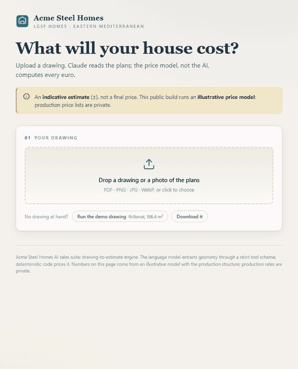
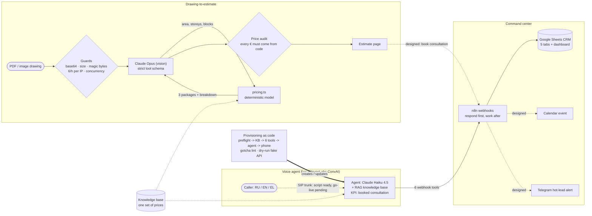
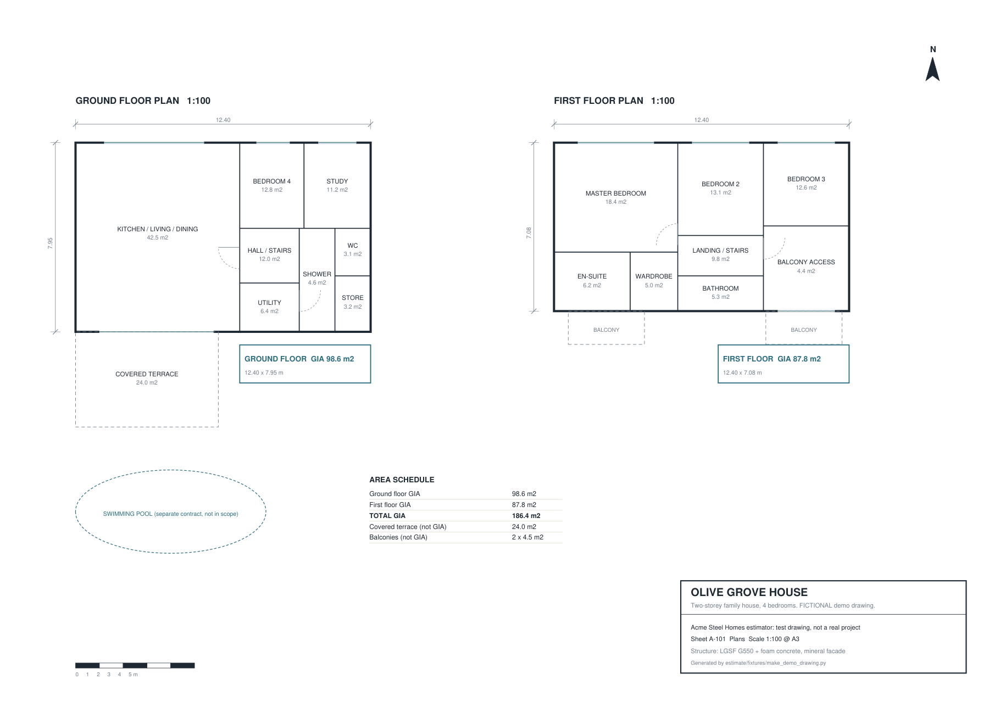

# Sales Voice Agent and Vision Cost Estimator

**An AI sales stack for an Eastern Mediterranean builder of energy-efficient steel-frame homes, shown here under the fictional name Acme Steel Homes. Eric, a trilingual voice agent built to qualify callers in Russian, English and Greek and book consultations with the partner architecture bureau (tested in the ElevenLabs console, telephony go-live pending), is provisioned end to end as code. A drawing-to-estimate engine lets Claude read a house drawing while deterministic code computes every euro, so a hallucinated price cannot reach a client. An n8n command center writes each lead into a Google Sheets CRM the owner can read on day one.**



| | |
|---|---|
| **Drawing -> estimate** | ~26 s and about $0.09 per drawing, measured on a real project drawing (304 m², 2 storeys, 2 blocks) |
| **Voice agent** | RU / EN / EL, 6 webhook tools, a 7-stage Design & Build funnel; provisioned by idempotent TypeScript steps (preflight, knowledge base, tools, agent, phone, teardown) |
| **CRM** | 5-tab Google Sheets (Leads, Calls, Bookings, Materials_Sent, Hot_Alerts) + a live dashboard |
| **Quality gates** | 59 eval checks (±1.5% price anchors, 378 page-vs-server comparisons) in under a second, 33 config and contract checks, strict `tsc`; all offline, no keys |
| **Landing page** | HTML 6.8 MB -> 215 KB, first mobile load 15.1 MB -> 1.9 MB, first open 3.0 s -> 0.5-1.3 s |
| **Stack** | TypeScript on Node 20+, ElevenLabs Conversational AI, Claude Opus (vision + tool use), Claude Haiku 4.5 (voice LLM), n8n, Google Sheets + Apps Script, SIP trunk (Telnyx), unpdf; landing: Next.js 16, three.js |

> **Prices in this repository are illustrative.** The estimator keeps the production structure (packages, per-m² curves, breakdown shares, bands) and the curve shapes, but every number is a placeholder: production price lists and supplier rates are private.

---

## How it works



Dashed arrows are designed, not built yet (see [Status](#status)).

## LLM extracts, code prices

The estimator's one rule: **the model is not allowed to name a price.**

1. **Claude reads the drawing** and reports what it sees through `report_extraction`, a strict tool schema (`strict: true`, `additionalProperties: false`): area, storeys, units, where the area came from, input quality and an honest confidence.
2. **Claude calls `estimate`** for all three packages. The tool runs `pricing.ts`: per-m² curves through anchor projects, a band that widens outside them, breakdown shares, and physical quantities from `costing.ts` (m³ of concrete, tonnes of steel, m² of facade) with a mandatory "needs current market prices" caveat.
3. **Claude writes a short note** from the tool results.
4. **Code audits the note.** Every euro figure in it must match (within 2%) a number the pricing code produced. If the model writes a price the code did not compute, the note is replaced by a code-written one before it reaches the client.

The result is testable like any other function: `npm run eval` checks prices against anchors, properties of the curves, the guards and the whole agentic loop, without a key.

## Engineering decisions

- **Guards before the paid call.** Strict base64, a 25 MB file / 5 MB image limit, a magic-bytes check (a renamed text file never reaches the model), 6 analyses per hour per IP where only analyses that actually start consume a slot, a concurrency cap of 2, and a 6-minute overall timeout that kills the in-flight request. A closed browser tab aborts the loop before the next paid turn.
- **Prompt caching across the tool loop.** Two static cache breakpoints (tools + system prompt, and the drawing) plus one breakpoint that moves to the latest tool result, so every later turn reads the multi-megabyte drawing from cache instead of paying for it again.
- **Two routes into the model.** PDFs up to 8 MB go in as documents (vision); heavier vector CAD sets, which the native reader rejects, go through unpdf as per-page text. On that route a prompt-injection filter removes instruction-shaped lines (EN / RU / EL) before the text enters the prompt, and a file cannot forge the end-of-data delimiter. Scans without a text layer are refused for free (422) instead of paying for a guaranteed failure.
- **Curves that cannot betray you.** The base curve interpolates *totals*, not rates: interpolating rates between steep anchors once made a larger house cheaper than a smaller one, and a dense monotonicity scan (25 to 1,200 m² in 5 m² steps) now guards every package. Outside the anchors the band widens and the client is told; below 25 m² (a room, not a house) or above 1,200 m² the model refuses instead of guessing.
- **The page cannot drift from the server.** The page carries an inline copy of the model so it works without a server. Eval compares the values *and runs the page's own pricing functions in a sandbox* against 378 server estimates plus 36 quantity texts. Making the check behavioural surfaced a real divergence in the production page: its offline copy kept a fixed band outside the anchor range while the server widened it. Fixed here.
- **A voice agent you can diff.** The agent, its 6 tools and its knowledge base are created by idempotent scripts that hand off through `state.json`. Updates always send a full baseline, because the API replaces top-level objects on PATCH. The transport is the system curl, because the WAF in front of the API rejected large PATCH bodies from Node fetch. [13 API pitfalls](docs/ELEVENLABS_GOTCHAS.md) are handled in code: 8 of them are a lint that runs before every create or update, and `npm run check:agent` proves each of those rules still fires on a deliberately broken copy; the other 5 live in the client (KB polling, the curl transport, idempotent re-runs).
- **Contracts between layers, checked.** Tool schemas, n8n workflows and the sheet schema are three files in three tools. A contract check verifies webhook paths, the "respond first" shape, the fields each workflow reads and the columns and statuses it writes. It caught one real mismatch: `book_consultation` wrote a status the Bookings tab's validation list did not allow.
- **Lean over heavy.** The client's own research proposed Retell + Bitrix24. ElevenLabs + n8n + Google Sheets was chosen instead: every lead lands in a spreadsheet the owner can read on day one, with nothing to license or onboard.

## The eval

`npm run eval` (output from the illustrative model, abridged; full run in the collapsible below):

```
── PRICE REGRESSION (midpoint vs anchor projects, +-1.5%) ──
✓ base      48 m2 ->   €25,900 vs   €25,900  KB 4.2 #1 bungalow, dev 0.0%
✓ turnkey  210 m2 ->  €312,900 vs  €312,900  reference duplex, dev 0.0%
✓ voice agent KB (knowledge_base.example.md) quotes the same prices as pricing.ts (6 projects)
── PROPERTY TESTS ──
✓ turnkey: total strictly increasing (dense scan 25-1200 m2, step 5)
✓ regression: rate interpolation makes 110 m2 (€42,625) dearer than 120 m2 (€42,000); total-space does not (€41,500)
── GUARDS (before, inside and after the paid call) ──
✓ injection filter: 5 instruction lines removed (EN/RU/EL), area labels kept
✓ price audit: code numbers pass (incl. "€288k"), an invented "€199,000" is caught
── AGENTIC LOOP on the offline replay transport (no key, no network) ──
✓ estimates in base -> shell -> turnkey order, identical to calling pricing.ts directly
✓ a note with an invented price is replaced by a code-written one before it reaches the client
── PAGE DRIFT: index.html inline model vs pricing.ts / costing.ts ──
✓ behaviour: page and server agree on 378 estimates (21 areas x 3 storeys x 3 packages x options)

✓ EVAL PASS: 59 checks in 0.2 s
```

<details>
<summary>Full <code>npm run eval</code> output</summary>

```
── PRICE REGRESSION (midpoint vs anchor projects, +-1.5%) ──
✓ base      48 m2 ->   €25,900 vs   €25,900  KB 4.2 #1 bungalow, dev 0.0%
✓ base      64 m2 ->   €33,300 vs   €33,300  KB 4.2 #3 studio, dev 0.0%
✓ base      82 m2 ->   €40,600 vs   €40,600  KB 4.2 #2 bungalow, dev 0.0%
✓ base     118 m2 ->   €48,400 vs   €48,400  KB 4.2 #6 house, dev 0.0%
✓ base     142 m2 ->   €54,700 vs   €54,700  KB 4.2 #5 townhouse, dev 0.0%
✓ base     176 m2 ->   €63,400 vs   €63,400  KB 4.2 #4 family house, dev 0.0%
✓ shell     48 m2 ->   €66,700 vs   €66,700  KB 4.2 #1 Option 2, dev 0.0%
✓ turnkey   48 m2 ->   €90,200 vs   €90,200  KB 4.2 #1 Option 3, dev 0.0%
✓ turnkey  210 m2 ->  €312,900 vs  €312,900  reference duplex, dev 0.0%
✓ voice agent KB (knowledge_base.example.md) quotes the same prices as pricing.ts (6 projects)

── PER-M2 CURVES (must fall with area) ──
✓ shell: 48 m2 1390 EUR/m2 > 210 m2 1060 EUR/m2
✓ turnkey: 48 m2 1880 EUR/m2 > 210 m2 1490 EUR/m2

   size       base                    shell                   turnkey
     48 m2   €24,900-€27,000         €62,000-€71,400         €83,900-€96,600
    106 m2   €44,000-€47,600         €125,400-€144,300       €171,600-€197,400
    152 m2   €54,900-€59,500         €166,500-€191,600       €230,400-€265,000
    210 m2   €71,100-€80,100         €207,000-€238,200       €291,000-€334,800
    260 m2   €85,400-€101,800        €249,700-€301,500       €351,100-€423,700
    320 m2   €104,800-€125,600       €298,500-€379,900       €419,600-€534,000

── BREAKDOWN SHARES = 100% ──
✓ base = 100%
✓ shell = 100%
✓ turnkey = 100%

── PROPERTY TESTS ──
✓ base: total strictly increasing (dense scan 25-1200 m2, step 5)
✓ shell: total strictly increasing (dense scan 25-1200 m2, step 5)
✓ turnkey: total strictly increasing (dense scan 25-1200 m2, step 5)
✓ regression: rate interpolation makes 110 m2 (€42,625) dearer than 120 m2 (€42,000); total-space does not (€41,500)
✓ package order turnkey > shell > base on the whole grid
✓ carport + septic add exactly €9,500 to both bounds
✓ breakdown sums to the total midpoint +-0.5% (every package, with and without options)
✓ options are their own breakdown rows; construction rows do not move
✓ curve.extrapolated: false inside the anchors, true outside
✓ band widens outside the anchors
✓ floors=0 normalises to 1
✓ foundation, frame and facade rows carry physical quantities + the mandatory caveat

── NEGATIVE TESTS ──
✓ area_m2=NaN -> clear error
✓ area_m2=-50 -> error
✓ package="premium" -> clear error
✓ package="toString" (prototype key) -> error
✓ area_m2=8 -> refused: probably a room, not the house
✓ area_m2=5000 -> refused: needs a manual estimate

── GROUNDED COSTING vs reference duplex (210 m2, 2 storeys) ──
✓ foundation €25,527 (48.3 m3, 4.3 t rebar) vs share €28,161, dev 9.4% (tolerance 25%)
✓ frame €51,392 (10.1 t of steel) vs share €56,322, dev 8.8% (tolerance 20%)
✓ steel: 1 storey 42.0 kg/m2 < 2 storeys 48.0 kg/m2 (no intermediate slab)
✓ facade of a 48 m2 bungalow is 72 m2 > its floor area (geometry, not a flat 0.9 x GFA)
✓ garbage overrides are clamped (slab 0.30 m, grade C25/30)

── GUARDS (before, inside and after the paid call) ──
✓ magic bytes: real PDF / PNG / JPEG headers accepted
✓ magic bytes: renamed text, a JPEG declared as PNG, a 4-byte stub -> rejected before any model call
✓ strict base64: garbage rejected, data: URL accepted
✓ rate limit: 6/hour per IP; rejected requests do not consume a slot; window slides; IPs are independent
✓ injection filter: 5 instruction lines removed (EN/RU/EL), area labels kept
✓ injection filter: a file cannot forge the end-of-data delimiter
✓ price audit: code numbers pass (incl. "€288k"), an invented "€199,000" is caught

── AGENTIC LOOP on the offline replay transport (no key, no network) ──
✓ 3 model turns: report_extraction -> estimate x3 -> note (got 3)
✓ extraction recorded through the strict tool: 186.4 m2, 2 storeys
✓ estimates in base -> shell -> turnkey order, identical to calling pricing.ts directly
✓ note quotes the code's numbers (€268,100-€308,500) and passes the price audit
✓ a note with an invented price is replaced by a code-written one before it reaches the client
✓ text route: the injected line never reaches the model, the area label does
✓ a closed tab aborts the loop before the next paid turn
✓ text fallback (unpdf) on the demo drawing: both floor totals and the 186.4 m2 total survive, nothing filtered
✓ extraction is coerced and clamped (confidence 7 -> 1, floors 0 -> 1, unknown quality -> sketch)

── PAGE DRIFT: index.html inline model vs pricing.ts / costing.ts ──
✓ values: all 12 model sections identical
✓ inline demo extraction = fixtures/demo-house.json
✓ UI price-model block found
✓ behaviour: page and server agree on 378 estimates (21 areas x 3 storeys x 3 packages x options)
✓ behaviour: 36 physical-quantity texts identical (foundation, frame, facade)

(drawing extraction skipped: add "-- extract" with a running live server)

✓ EVAL PASS: 59 checks in 0.2 s
```
</details>

`npm run eval -- extract` adds the live part: it sends real drawings through a running server and compares the extracted area, storeys and units with ground truth. The repository ships one case, the fictional demo drawing; private drawings go in the gitignored `extract-cases.local.json`.

## The demo drawing and offline mode

Without an `ANTHROPIC_API_KEY` the server starts in **demo mode**. Every guard runs exactly as in production, then the model's side of the loop is replayed from a fixture: a fictional two-storey house ([`estimate/fixtures/demo-house.pdf`](estimate/fixtures/demo-house.pdf), generated by a script in the same folder). The replay drives the real agentic loop, so the tools run, `pricing.ts` prices, and the note is audited; only the model call is scripted. The page says so in a banner ([full result page](docs/estimator.png)).



## The voice agent, as code

```
npm run setup:dry
=== 02-create-tools (dry run) ===
  [dry-run] POST   /v1/convai/tools  (2.3 kB)  tool create_lead -> https://example.com/webhook/create-lead
  ...
=== 03-create-agent (dry run) ===
[03 agent] Languages: en + presets ru,el | TTS eleven_multilingual_v2
[03 agent] ✓ Baseline passes the gotcha lint
  [dry-run] POST   /v1/convai/agents/create  (26.3 kB)  agent "Eric - Acme Steel Homes" lang=en+ru,el tts=eleven_multilingual_v2 llm=claude-haiku-4-5 tools=6 prompt=22238 chars
Setup dry run complete in 0.8 s.
```

A second dry run shows the idempotency: the knowledge base is "already indexed", all 6 tools "unchanged", and the agent gets a safe PATCH with the full baseline. Eric's playbook covers 7 caller segments (local and expat families, land-for-flats landowners, developers, investors, hospitality, difficult plots), objection handling, tool rules and hard guardrails: no exact turnkey totals for custom projects, no tax advice, no personal identifiers, no invented facts. Details in [voice-agent/](voice-agent/) and [command-center/](command-center/).

## The 3D landing page

A bilingual sales page for a reference duplex with a 161-frame flyover scrubbed by scroll. The flyover codec was chosen by SSIM (AVIF 0.9899 at 8.3 MB vs 13.5 MB for WebP) and the clip seams were verified with PSNR. Its source is not included because it is built around a third-party bureau's BIM model and renders; the method and the before/after numbers are in [docs/LANDING_PAGE.md](docs/LANDING_PAGE.md).

## Run it

```bash
git clone https://github.com/AverageCargo87/sales-voice-agent-vision-estimator
cd sales-voice-agent-vision-estimator
npm install
npm test                 # typecheck + agent config checks + eval: offline, no keys
npm run estimate         # http://127.0.0.1:8099 in demo mode; press "Run the demo drawing"
npm run setup:dry        # provision the voice agent against the local fake API
```

For live runs, copy `.env.example` to `.env`: `ANTHROPIC_API_KEY` switches the estimator to live mode; `ELEVENLABS_API_KEY`, `ELEVENLABS_VOICE_ID` and `N8N_WEBHOOK_BASE` enable `npm run setup`. The estimator API: `POST /api/estimate` (pure parametric, no AI), `POST /api/analyze` (drawing -> agentic loop), `GET /api/demo`, `GET /api/model`, `GET /healthz`.

## Repository layout

```
voice-agent/
  config/            agent.json (static baseline), tools.json (6 webhook tools)
  prompts/           system_prompt.md (Eric)
  scripts/           00-preflight ... 04-attach-phone, 99-teardown, setup runner, check-config
  scripts/utils/     ElevenLabs client (curl transport), baseline builder, gotcha lint, dry-run fake API
  knowledge_base.example.md
command-center/
  n8n/               create_lead, book_consultation, CRM setup
  sheets/            setup-crm-sheet.gs (5 tabs + dashboard)
estimate/
  agent.ts           the agentic loop, pluggable transport (live curl / offline replay)
  pricing.ts         the price model (illustrative numbers)
  costing.ts         physical quantities behind foundation, frame, facade
  guards.ts          base64, magic bytes, rate limiter, injection filter, narrative price audit
  replay.ts          offline replay of the model side
  server.ts          node:http server, demo mode
  index.html         the estimate page (no build step)
  eval.ts            the harness
  fixtures/          demo-house.json / .pdf, extraction cases
docs/                ELEVENLABS_GOTCHAS.md, LANDING_PAGE.md, visuals, capture script
shared/              logger
```

## Status

- **Estimator:** built and tested on a real project drawing (the ~26 s / ~$0.09 measurement) and deployed as a demo for the client. The owner's feedback from the first real test: the price band is too wide, because the production model is calibrated on one complete bill of quantities. Calibrating on more completed projects is the next step. This repository is the open copy with an illustrative price model.
- **Voice agent:** built and tested in the ElevenLabs console, with lead capture into the CRM verified. Telephony go-live is pending: the agent has not taken live calls yet. Evaluation criteria are configured; there are no evaluation results to report.
- **Command center:** `create_lead`, `book_consultation` and the CRM setup are built. The other four tool workflows, Calendar sync and Telegram hot-lead alerts are designed (their tool schemas are in `tools.json`), not built.
- **Landing page:** deployed on Vercel; the code is not part of this repository.
- The published prompt and knowledge base are English translations of the Russian production versions, with the company renamed, partner names generalised and prices replaced by illustrative ones.
- The live extraction eval on the demo drawing is ready to run with a key; it was not run for this README.

Code was written AI-first with Claude Code; architecture, decisions and acceptance are mine.

## License

MIT
